# Urgences Médicales 🏥

> Application web de gestion d'un service d'urgences hospitalier : triage des patients, suivi des lits et équipements, **banque de sang** (stock, donneurs, demandes), tableau de bord statistique, accès par rôle et journal d'activité.

Projet universitaire (Licence 3 Informatique, Systèmes d'Information, UGB Saint-Louis) développé en **PHP (architecture MVC), MySQL, HTML/CSS et JavaScript**, sans framework.

**🔗 Démo en ligne : https://urgences-medicales-kane.wuaze.com**

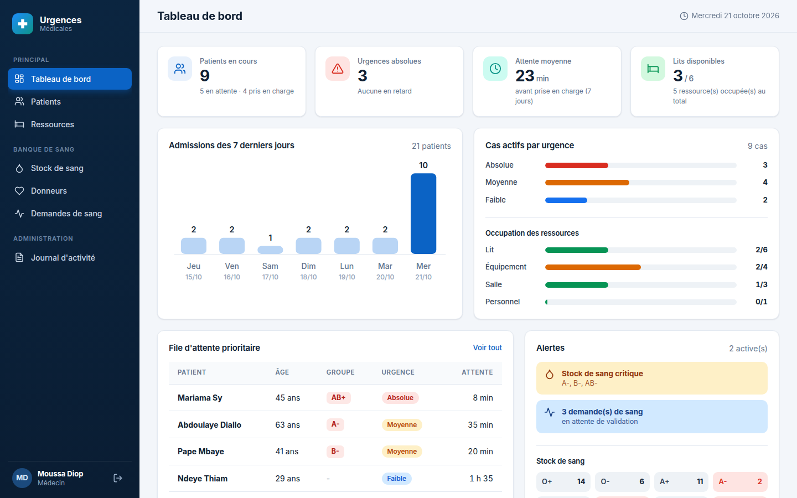

---

## Sommaire

1. [Fonctionnalités](#fonctionnalités)
2. [Aperçu](#aperçu)
3. [Rôles et permissions](#rôles-et-permissions)
4. [Architecture](#architecture)
5. [Sécurité](#sécurité)
6. [Installation](#installation)
7. [Déploiement](#déploiement)
8. [Structure du projet](#structure-du-projet)
9. [Modèle de données](#modèle-de-données)
10. [Limites et pistes d'évolution](#limites-et-pistes-dévolution)
11. [Auteur](#auteur)

## Fonctionnalités

### Urgences et ressources
| Fonction | Détail |
|---|---|
| **Triage** | Degré d'urgence (Absolue, Moyenne, Faible) et statut (En attente, En prise en charge, Traité) |
| **File d'attente prioritaire** | Classement par statut, gravité, puis ordre d'arrivée ; alerte visuelle si une urgence absolue attend plus de 15 min |
| **Temps d'attente** | Heure d'admission, début et fin de prise en charge enregistrés automatiquement ; délai moyen calculé |
| **Recherche et filtres** | Par nom, statut, urgence ; pagination |
| **Export CSV** | Compatible Excel (séparateur `;`, UTF-8) ; neutralise les formules malveillantes |
| **Ressources** | Lits, équipements, salles, personnel ; statuts Disponible / Occupé / En maintenance |
| **Libération automatique** | Passer un patient à « Traité » libère ses ressources |

### Banque de sang (nouveau)
| Fonction | Détail |
|---|---|
| **Stock par groupe** | 8 groupes sanguins, jauge et seuil d'alerte, état « Critique » automatique |
| **Donneurs** | Fichier des donneurs avec éligibilité calculée (délai minimal entre deux dons : 56 jours, configurable) |
| **Enregistrement d'un don** | Refusé automatiquement avant le délai ; ajoute une poche au stock (transaction) |
| **Demandes de sang** | Un soignant demande des poches pour un patient ; le médecin satisfait (déduit du stock) ou refuse |
| **Garde-fous** | Impossible de satisfaire une demande si le stock est insuffisant ; groupes compatibles suggérés |
| **Compatibilité ABO / Rhésus** | Tableau de référence receveur / donneur |

### Pilotage et traçabilité (nouveau)
| Fonction | Détail |
|---|---|
| **Tableau de bord** | Indicateurs clés, admissions des 7 derniers jours, répartition des urgences, occupation des ressources, alertes, stock de sang (graphiques en SVG, sans bibliothèque) |
| **Journal d'activité** | Connexions, admissions, modifications, suppressions, dons, demandes ; filtrable, réservé aux médecins |
| **Interface** | Design responsive (ordinateur, tablette, téléphone), police Inter |

## Aperçu

| Connexion | Patients |
|---|---|
| 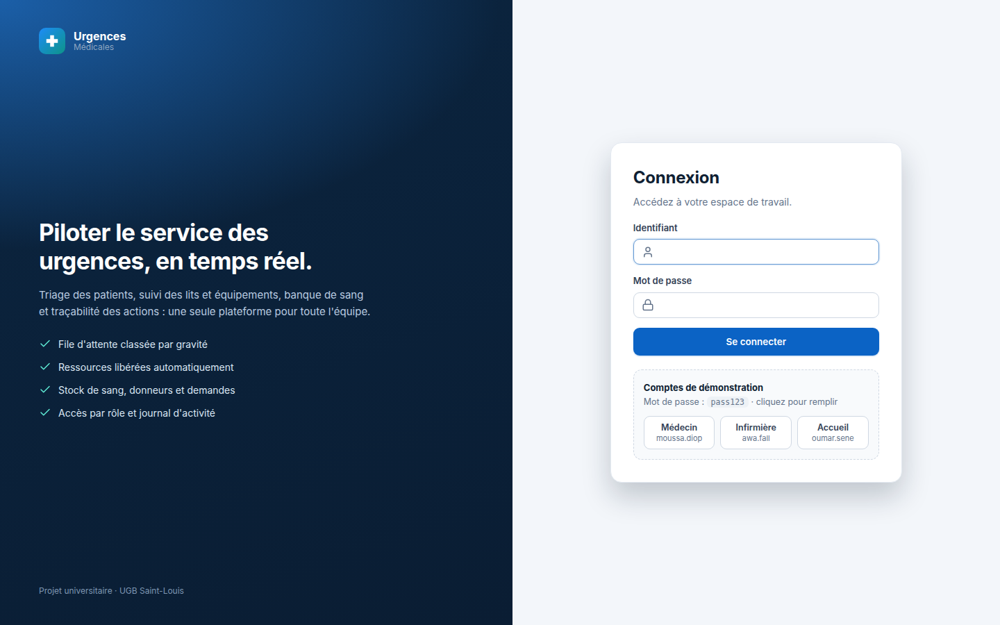 | 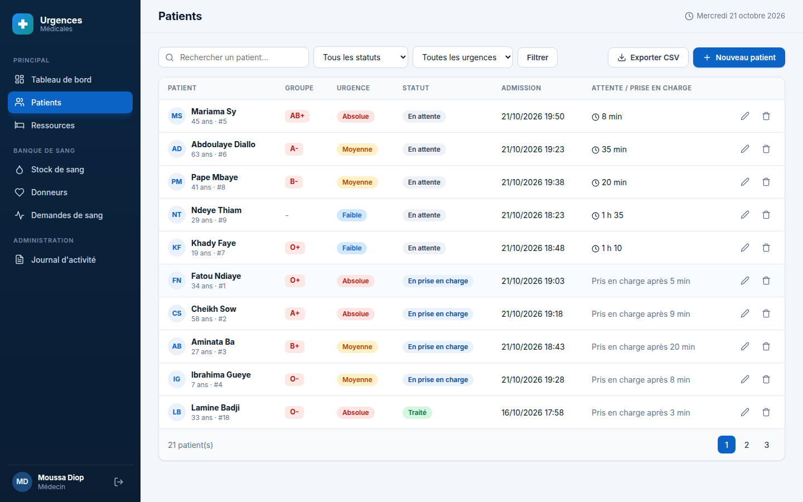 |

| Ressources | Banque de sang |
|---|---|
| 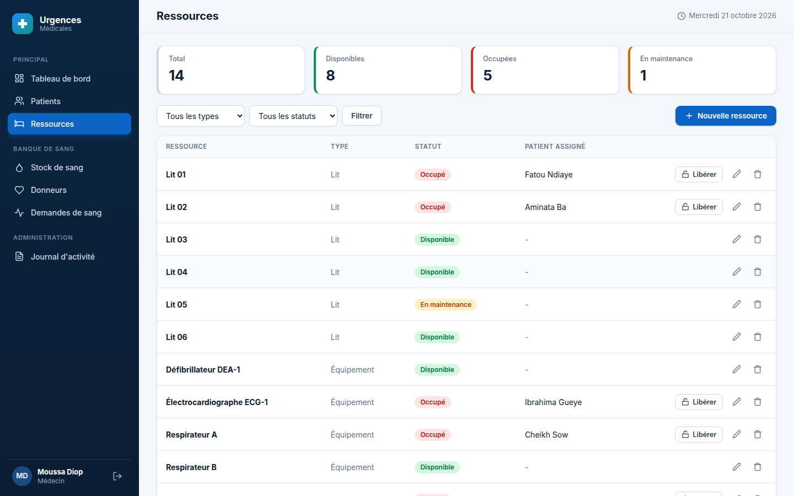 | 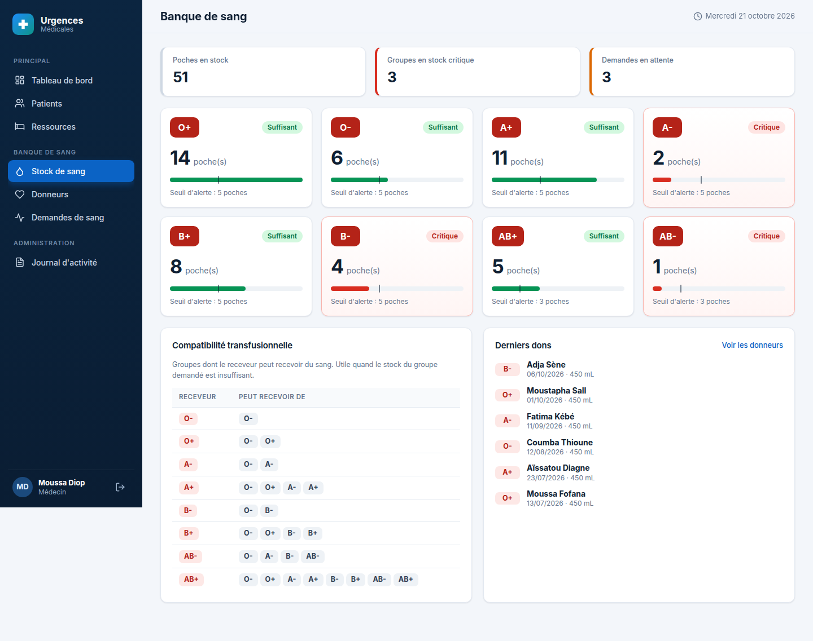 |

| Donneurs | Demandes de sang |
|---|---|
| 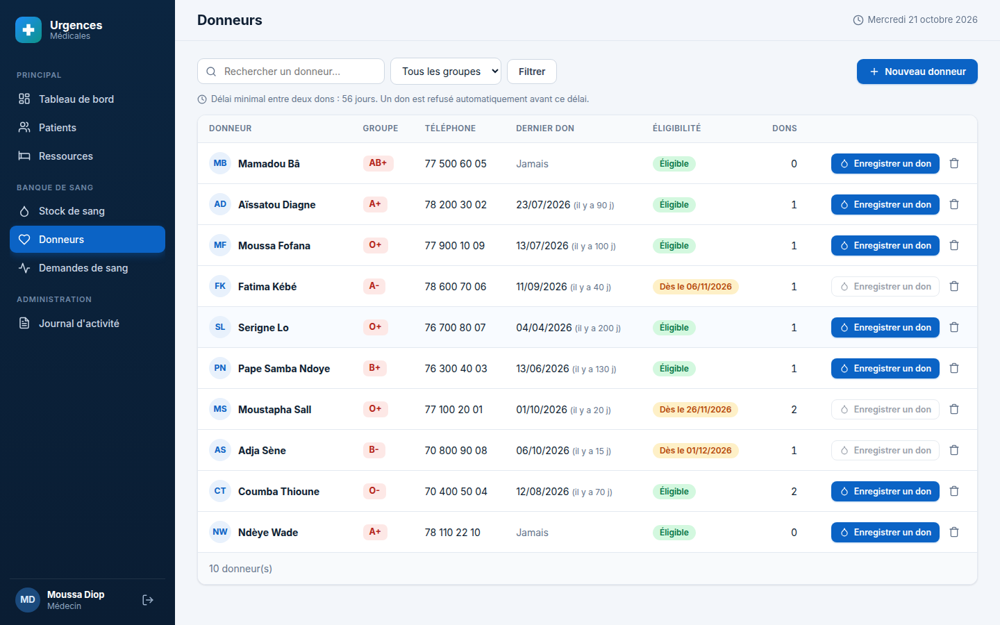 | 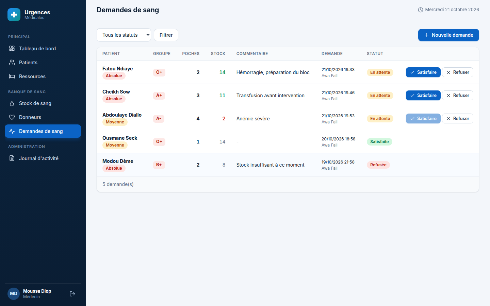 |

| Journal d'activité | Formulaire patient |
|---|---|
| 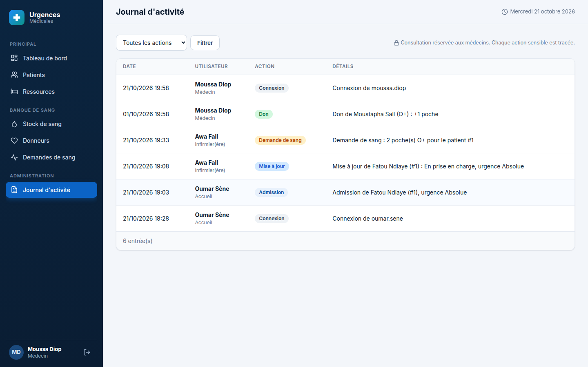 | 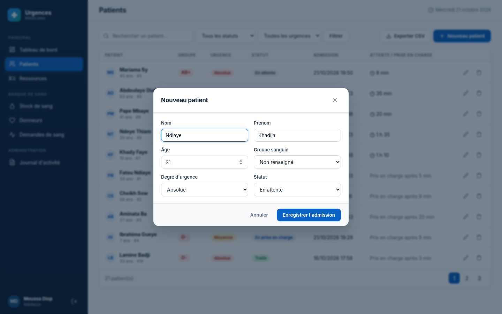 |

<p align="center">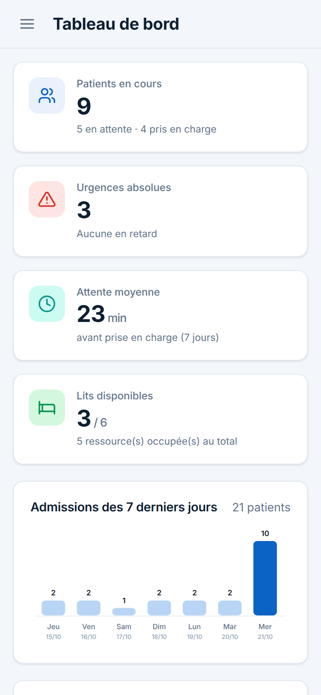</p>

## Rôles et permissions

Une matrice unique (`core/Auth.php`) est vérifiée par le routeur avant chaque action.

| Fonction | Médecin | Infirmier(ère) | Accueil |
|---|:-:|:-:|:-:|
| Tableau de bord, liste des patients, admission | ✅ | ✅ | ✅ |
| Modifier un patient, exporter en CSV | ✅ | ✅ | ❌ |
| Supprimer un dossier patient | ✅ | ❌ | ❌ |
| Ressources (voir et gérer) | ✅ | ✅ | ❌ |
| Banque de sang : consulter, enregistrer dons et demandes | ✅ | ✅ | ❌ |
| **Satisfaire ou refuser une demande de sang** | ✅ | ❌ | ❌ |
| Journal d'activité | ✅ | ❌ | ❌ |

**Comptes de démonstration** (mot de passe : `pass123`) : `moussa.diop` (médecin), `awa.fall` (infirmière), `oumar.sene` (accueil).

## Architecture

Architecture **MVC** avec un point d'entrée unique et une table de routes.

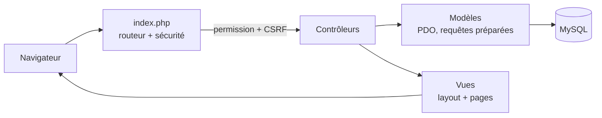

- **`index.php`** : charge la configuration, démarre la session, puis pour chaque route vérifie *la permission du rôle*, *le verbe HTTP* et *le jeton CSRF* avant d'appeler le contrôleur.
- **Contrôleurs** : valident la saisie, appellent les modèles, enregistrent dans le journal.
- **Modèles** : toutes les requêtes sont préparées (PDO). Les opérations sensibles (don, demande de sang) utilisent des **transactions** avec verrouillage de ligne pour éviter les incohérences de stock.
- **Vues** : gabarit commun (menu latéral adapté au rôle), échappement systématique des données.

## Sécurité

| Risque | Protection |
|---|---|
| Identifiants de la base dans le code | Configuration externe `config/config.php`, **ignorée par Git** |
| Injection SQL | Requêtes préparées partout (PDO, émulation désactivée) |
| XSS | Échappement de toutes les sorties (`e()`) |
| CSRF | Jeton par session sur tous les formulaires ; suppressions en **POST uniquement** |
| Mots de passe | Hachage `password_hash` / `password_verify` |
| Fixation de session | `session_regenerate_id` à la connexion ; cookies `HttpOnly` et `SameSite` |
| Force brute | Verrou de 30 secondes après 5 échecs |
| Accès non autorisé | Contrôle du rôle à chaque route (403) |
| Fuite d'informations | Erreurs détaillées masquées en production, écrites dans les logs |
| Injection de formules CSV | Préfixe des cellules dangereuses à l'export |

## Installation

**Prérequis** : PHP 7.4 ou plus (extensions `pdo_mysql`), MySQL ou MariaDB. Sous Windows, [WampServer](https://www.wampserver.com/) ou XAMPP conviennent.

1. **Copier le projet** dans le dossier web (`www` pour Wamp, `htdocs` pour XAMPP).
2. **Créer la base** dans phpMyAdmin : nom `urgences_db`, interclassement `utf8mb4_unicode_ci`.
3. **Importer** dans cette base, dans cet ordre :
   - `database/schema.sql` (structure) ;
   - `database/donnees_demo.sql` (données fictives de démonstration).
4. **Configurer** : copier `config/config.example.php` en `config/config.php`, puis renseigner l'hôte, le nom de la base, l'utilisateur et le mot de passe.
5. **Ouvrir** `http://localhost/urgences-medicales/` et se connecter avec un compte de démonstration.

> ⚠️ `schema.sql` supprime les tables existantes du projet avant de les recréer.

Sans serveur local : `php -S localhost:8000` dans le dossier du projet, puis `http://localhost:8000`.

## Déploiement

L'application nécessite PHP et MySQL : elle ne peut pas être hébergée sur GitHub Pages. Un hébergement gratuit comme InfinityFree convient :

1. Créer la base MySQL depuis le panneau de l'hébergeur et noter l'hôte, le nom, l'utilisateur et le mot de passe fournis.
2. Importer `schema.sql` puis `donnees_demo.sql` via phpMyAdmin.
3. Envoyer les fichiers dans `htdocs` (FTP ou gestionnaire de fichiers), puis créer **sur le serveur** le fichier `config/config.php` avec ces identifiants.
4. Pour un site public, mettre `'debug' => false` et `'demo_comptes' => false` dans `config/config.php`, et **changer les mots de passe des comptes**.

## Structure du projet

```
urgences-medicales/
├── index.php                  point d'entrée : routes, permissions, CSRF
├── config/
│   └── config.example.php     modèle de configuration (config.php est ignoré par Git)
├── core/                      Config, Database, Auth, View, fonctions utilitaires
├── controllers/               Utilisateur, Dashboard, Patient, Ressource, Sang, Journal
├── models/                    accès aux données (PDO) et indicateurs
├── views/                     gabarit, tableau de bord, patients, ressources, sang, journal
├── assets/css, assets/js      feuille de style (design system) et interactions
├── database/
│   ├── schema.sql             structure de la base
│   └── donnees_demo.sql       données fictives
└── docs/screenshots/          captures d'écran
```

## Modèle de données

`utilisateur` · `patient` · `ressource` · `stock_sang` · `donneur` · `don` · `demande_sang` · `journal`

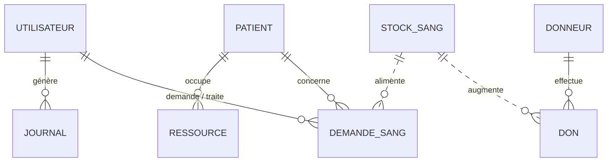

## Limites et pistes d'évolution

**Limites actuelles**
- Les données de démonstration sont **fictives** ; l'application n'est pas certifiée pour un usage clinique réel (données de santé : conformité réglementaire à prévoir).
- Pas encore de gestion des utilisateurs depuis l'interface (comptes créés en base).
- Pas de tests automatisés dans le dépôt.

**Pistes d'évolution**
- Écran d'administration des comptes et changement de mot de passe.
- Fiche patient détaillée (historique, ressources, demandes de sang).
- Statistiques avancées et exports (temps d'attente par gravité, heures de pointe) pour l'aide à la décision.
- Notifications en temps réel (alertes de stock, urgences en retard).
- API REST et tests automatisés.

## Auteur

**Aminetou Kane** - Licence 3 Informatique (Systèmes d'Information), Université Gaston Berger de Saint-Louis.

[GitHub](https://github.com/aminetou-kane) · [LinkedIn](https://linkedin.com/in/aminetou-kane-0b05a12a7)

## Licence

Distribué sous licence MIT (voir [LICENSE](LICENSE)).
